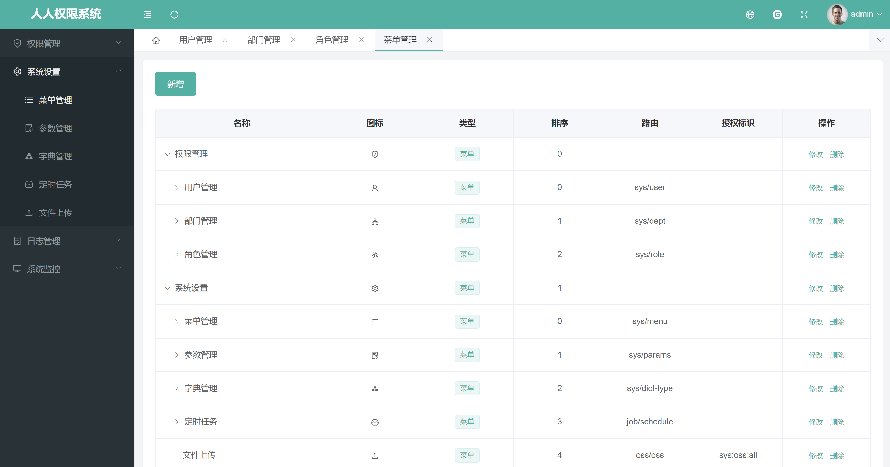

<div align="center">

# 🚗 驾考通 Driver Exam

**一套开箱即用的驾考学习平台：管理后台 + 移动端 App / 小程序 + AI 智能助手 + 积分商城**

[](https://spring.io/projects/spring-boot)
[](https://vuejs.org/)
[](https://www.typescriptlang.org/)
[](https://element-plus.org/)
[](https://uniapp.dcloud.net.cn/)
[](https://java.agentscope.io/)
[](https://www.mysql.com/)
[](LICENSE)

</div>

---

## 🔗 源码仓库

| 端 | 仓库地址 |
| --- | --- |
| 后端服务（管理后台 / API / AI / VOD） | [https://github.com/jiangshang-dev/driver-exam](https://github.com/jiangshang-dev/driver-exam) |
| 移动端（App / H5 / 微信小程序） | [https://github.com/jiangshang-dev/drive-test-app](https://github.com/jiangshang-dev/drive-test-app) |

> 建议先 Star 两个仓库再 Clone，方便后续第一时间获取功能更新与问题修复。

---

> ### ⭐ Star First, Clone Later
>
> **如果这个项目对你有帮助，请先点一下右上角的 Star 再 Clone。**
> 不 Star 直接 Clone 的话……项目可能会在凌晨三点给你抛一个 `NullPointerException` 😄
> （开玩笑的。但 Star 是开源作者持续迭代最大的动力。）

---

## 📖 项目简介

**驾考通（Driver Exam）** 是一个面向驾考场景的全栈学习平台，包含：

- **管理后台**：题库、视频、用户、学习记录、积分商城、AI 模型配置、系统权限等一整套运营能力
- **移动端**：基于 uni-app，一套代码运行在 App / H5 / 微信小程序
- **AI 智能助手**：基于 AgentScope 的多轮对话、流式输出、思考过程展示
- **文件与视频**：统一文件服务器、大文件分片断点续传、阿里云 VOD 视频点播

项目在 renren-security 成熟的权限体系之上，补齐了完整的驾考业务、AI 能力与商城体系。代码结构清晰、模块边界明确，既适合作为**毕业设计 / 课程设计**，也可以直接用于**企业级项目与商业产品二次开发**。

> 💼 **本项目允许商业使用**：采用 Apache License 2.0，个人与企业均可免费用于商业项目，无需额外授权或授权费用，详见下方「商业使用」章节。

---

## ✨ 功能一览

### 📚 学习与考试
- 顺序练习、章节练习、随机练习
- 全真模拟考试、考试倒计时、自动交卷、成绩解析
- 错题本、收藏夹、答题记录
- 学习记录、考试记录、学习统计（正确率 / 学习时长 / 积分）
- 交通标志、图标技巧、知识卡片
- 每日签到、积分奖励

### 🎬 内容与视频
- 交规视频管理、分类、上下架、审核
- 视频评论、点赞、评论审核
- 视频播放（阿里云 VOD / 直链播放）
- 视频封面、附件上传

### 🤖 AI 智能助手
- 多轮会话记忆（Redis 状态存储）
- SSE 流式输出、思考过程 / 工具调用过程展示
- 会话与消息持久化（`ai_chat_session` / `ai_chat_message`）
- 模型配置管理：普通大模型（原生多模态）、向量模型、TTS 语音模型
- 同类型模型仅允许启用一个，支持参数预设（创意 / 平衡 / 精确）、温度、top_p、惩罚项、最大回复
- 模型连通性测试

### 🛒 积分商城与会员
- 商品管理（虚拟 / 实物、积分价、现金价、封面图、库存、上下架）
- 会员套餐管理（月卡 / 季卡 / 年卡）
- 积分规则、积分流水
- 订单管理（详情、实物发货、标记已支付）
- 会员中心、VIP 权益、积分商城、购物车、支付流程

### 🛠 系统与权限
- 用户 / 角色 / 菜单 / 部门 / 岗位管理
- 按钮级权限、数据权限
- 字典、参数、定时任务、日志、系统监控
- 多数据源、代码生成器
- 登录方式：账号密码、手机号验证码（验证码登录自动注册）、微信小程序一键登录

---

## 🛣️ 持续迭代

项目仍在**持续完善和优化**中，功能与体验会不断更新，不是一次性交付的静态代码：

- 持续补充业务功能，修复使用过程中发现的问题
- 持续优化接口性能、页面加载速度与移动端交互体验
- 持续增强 AI 能力（多模型接入、多模态、语音、知识库等）
- 计划方向：管理后台数据看板、支付/短信服务商对接、更多对象存储适配、题库与考试体验优化
- 所有更新会同步到后端仓库与移动端仓库，建议 **Watch + Star** 获取最新版本
- 欢迎通过 Issue 反馈 Bug 或新需求，也欢迎 Pull Request 一起完善

---

## 💼 商业使用

- 本项目采用 **Apache License 2.0**，**允许个人和企业免费商用**，包括闭源商用、私有化部署和二次开发，无需额外授权，也没有授权费用
- 商用时请保留项目原始的版权声明与 [LICENSE](LICENSE) 文件
- 项目按「现状」提供，不附带任何明示或暗示的担保；因使用本项目产生的风险由使用者自行承担
- 如用于商业项目，欢迎 Star 支持，也欢迎在项目介绍中注明来源（非强制）
- 如需深度定制、功能扩展或技术合作，欢迎通过 Issue 联系交流

---

## 📤 文件上传能力

| 能力 | 说明 |
| --- | --- |
| 统一文件服务器 | 图片 / 普通文件走 `sys/oss/upload`，支持**七牛云、阿里云 OSS、腾讯云 COS、MinIO、RustFS** |
| 配置即用 | 后台「系统设置 → 文件上传」配置哪家，文件就存哪家，业务代码零改动 |
| 大文件分片上传 | `sys/oss/chunk/init` → `upload` → `merge`，支持视频与常见文档/压缩包 |
| 断点续传 | 分片落盘 + 上传进度查询（`status`），暂停、刷新、重进页面后可按分片续传 |
| 分片合并 | 服务端流式合并后上传到当前配置的文件服务器，S3/MinIO/RustFS 全程流式写入，不占大内存 |
| 原有能力保留 | 阿里云 VOD 视频点播上传保持不变，可在「视频上传」页面自由切换 |
| 上传记录 | 合并成功后写入上传记录，支持视频在线播放、其他文件预览/下载 |

---

## 🧱 技术选型

| 分类 | 技术 |
| --- | --- |
| 后端框架 | Spring Boot 3.x、Spring MVC |
| 安全框架 | Apache Shiro 1.12、JWT Token |
| 持久层 | MyBatis-Plus 3.5、Druid 连接池 |
| 数据库 | MySQL 8.0+（同时提供达梦 8 / Oracle / SQL Server / PostgreSQL 脚本） |
| 缓存 | Redis |
| 定时任务 | Quartz 2.3 |
| 文档 | Swagger / OpenAPI 3（doc.html） |
| AI | AgentScope 2.0（ReActAgent / HarnessAgent）、OpenAI 兼容协议、SSE |
| 管理端 | Vue 3、TypeScript、Element Plus、Vue Router、Pinia、Axios、Vite |
| 移动端 | uni-app（Vue 3 + TS），支持 App / H5 / 微信小程序 |
| 视频 | 阿里云 VOD、S3 协议对象存储 |
| 构建 | Maven 3.6+、JDK 21 |

---

## 🗂 项目结构

```text
driver-exam
├─ db/                          数据库脚本（商城、学习、AI 等业务表）
├─ driver-exam-common           公共模块（Result、分页、异常、工具、Redis、OSS 抽象）
├─ driver-exam-dynamic-datasource 多数据源模块
├─ driver-exam-business         业务模块（用户、题库、视频、商城、学习、AI 持久化等）
├─ driver-exam-admin            管理后台服务（8080，/renren-admin）
│   ├─ modules
│   │   ├─ ai                  AI 模型配置与对话
│   │   ├─ oss                 文件上传 / 大文件分片
│   │   ├─ sys                 系统管理（用户、角色、菜单、字典、日志...）
│   │   ├─ traffic             交规视频、评论、标志
│   │   ├─ user                会员用户
│   │   ├─ mall                积分商城 / 会员 / 订单
│   │   ├─ learning            学习记录 / 考试记录
│   │   └─ ...
│   └─ resources
│       ├─ mapper              MyBatis XML
│       └─ application.yml     全局配置
├─ driver-exam-api              API 服务（8081，/api，App / 小程序端）
├─ driver-exam-vod              视频点播服务（8082，阿里云 VOD + S3）
├─ driver-exam-ai               AI 能力模块（AgentScope、会话记忆、模型工厂）
├─ driver-exam-generator        代码生成器
├─ driver-exam-ui               管理后台前端（Vue3 + TS + Element Plus）
└─ pom.xml                      Maven 聚合工程
```

移动端工程 `drive-test-app` 为独立的 uni-app 项目（App / H5 / 微信小程序），源码地址：[https://github.com/jiangshang-dev/drive-test-app](https://github.com/jiangshang-dev/drive-test-app)。

---

## 📐 代码结构与规范

### 后端
- **分层**：`Controller` → `Service` → `ServiceImpl` → `Dao` → `Entity` / `DTO`
- **统一返回**：所有接口返回 `Result<T>`，分页统一使用 `PageData<T>`
- **统一异常**：业务异常抛 `RenException`，由全局异常处理器统一输出
- **CRUD 封装**：提供 `CrudService` / `CrudServiceImpl` / `BaseDao`，简单业务无需重复写增删改查
- **权限控制**：`@RequiresPermissions("模块:功能:动作")`，菜单权限精确到按钮
- **日志审计**：`@LogOperation` 自动记录后台操作日志
- **DTO 隔离**：实体与传输对象分离，避免直接暴露数据库结构
- **AI 模块**：模型工厂、Agent 工厂、状态存储、思考过程编解码独立解耦，便于替换模型供应商

### 前端（管理后台）
- **目录**：`views` 页面、`components` 公共组件、`service` 请求封装、`hooks` 组合式函数
- **页面范式**：`xxx.vue`（列表 + 查询 + 分页）+ `xxx-add-or-update.vue`（表单弹窗）
- **状态管理**：Pinia，登录态、权限、菜单统一维护
- **请求**：Axios 统一拦截器，自动携带 token、统一错误提示
- **权限**：`state.hasPermission('xxx:xxx:xxx')` 控制按钮显隐
- **组件复用**：视频播放、封面/图片上传、大文件分片上传、AI 消息渲染等均为公共组件

### 移动端
- **页面**：`pages/` 按业务模块划分，`pages.json` 统一路由
- **请求**：`utils/http.ts` 统一封装，自动注入 token
- **状态**：Pinia（会员、考试类型等）
- **平台适配**：`uniPlatform` 判断，H5 / App / 小程序按能力降级

### 命名约定
- 类名大驼峰、方法与变量小驼峰、常量全大写下划线
- 数据库表小写下划线，实体字段驼峰自动映射
- 权限标识统一 `模块:功能:动作`，如 `mall:goods:update`

---

## 🚀 快速开始

### 1. 环境要求
- JDK 21（最低 17）
- Maven 3.6+
- MySQL 8.0+（或达梦 8 / Oracle / SQL Server / PostgreSQL）
- Redis
- Node.js 18+ / pnpm（或 npm）
- HBuilderX（运行 App / 小程序时需要）

### 2. 初始化数据库
1. 创建数据库 `drive`，字符集 `utf8mb4`
2. 执行 `driver-exam-admin/db/mysql.sql` 初始化系统表
3. 按需执行业务脚本：
   - `db/mall_member.sql`（积分商城 / 会员）
   - `db/study_feature.sql`（学习功能）
   - `db/ai_model.sql`（AI 模型配置）
   - `driver-exam-ai/db/ai_chat.sql`（AI 会话 / 消息）
   - `driver-exam-vod/src/main/resources/db/vod.sql`（视频点播）

### 3. 启动后端
```bash
# 根目录安装依赖并编译
mvn clean install -DskipTests

# 管理后台
# 运行 driver-exam-admin 下的 AdminApplication
# http://localhost:8080/renren-admin
# 接口文档：http://localhost:8080/renren-admin/doc.html

# API 服务（App / 小程序）
# 运行 driver-exam-api 下的 ApiApplication
# http://localhost:8081/api

# 视频点播服务（可选）
# 运行 driver-exam-vod 下的 DriverExamVodApplication
# http://localhost:8082
```

数据库账号、Redis、文件服务器、AI 模型等配置见 `application-dev.yml`。

AI 模型有两种配置方式：
1. 后台「AI 管理 → 模型配置」新增并启用模型（推荐）
2. 环境变量兜底：`DASHSCOPE_API_KEY`、`DASHSCOPE_BASE_URL`、`DASHSCOPE_MODEL`

### 4. 启动管理后台前端
```bash
cd driver-exam-ui
pnpm install      # 或 npm install
pnpm dev
```

### 5. 启动移动端
用 HBuilderX 打开 `drive-test-app`：
- 运行到浏览器（H5）
- 运行到手机或模拟器（App）
- 运行到微信开发者工具（小程序）

### 6. 默认账号
- 管理后台：`admin / admin`
- 移动端：手机号验证码登录（验证码在后端日志中搜索「【登录验证码】」），或注册账号后使用用户名密码登录

---

## 📸 界面预览

<div align="center">



</div>

---

## ❓ 常见问题

**Q：登录提示「该账号未设置密码」？**
A：微信登录自动创建的用户没有密码，请使用手机号验证码登录，或在后台「用户管理」中设置密码。

**Q：验证码收不到？**
A：项目默认未接入短信服务商，验证码会打印在 `driver-exam-api` 后端日志中，搜索「【登录验证码】」即可。

**Q：上传的文件访问 404 / 无法预览？**
A：检查「系统设置 → 文件上传」配置的 endpoint、bucket、domain 是否正确，以及对象存储是否允许公网访问 / 配置了跨域。

**Q：大文件上传中断后要重新传吗？**
A：不需要。分片会保留在服务端临时目录，重新选择同一个文件会从已上传的分片继续。

**Q：AI 对话报模型不可用？**
A：先在「AI 管理 → 模型配置」里新增模型并点「测试可用」，确认 api 地址、密钥、模型名正确，再点「启用」。

---

## 🤝 参与贡献

项目会长期维护、持续迭代，欢迎一起把它做得更好：

1. Fork 对应仓库
   - 后端：[jiangshang-dev/driver-exam](https://github.com/jiangshang-dev/driver-exam)
   - 移动端：[jiangshang-dev/drive-test-app](https://github.com/jiangshang-dev/drive-test-app)
2. 新建分支：`feature/your-feature` 或 `fix/your-fix`
3. 提交代码：建议使用 `feat: xxx`、`fix: xxx`、`docs: xxx` 规范
4. 发起 Pull Request，说明改动内容和测试情况

发现 Bug 或有新需求，欢迎提交 Issue；有价值的建议会优先排期实现。

**如果这个项目帮到了你，别忘了点一个 ⭐ Star，这是对开源最好的支持。**

---

## 📄 License

本项目基于 [Apache License 2.0](LICENSE) 开源：

- ✅ 允许商业使用、修改、分发、私有化部署与闭源集成
- ✅ 无需支付授权费用
- ⚠️ 请保留原始版权声明与 LICENSE 文件
- ⚠️ 软件按「现状」提供，不附带任何担保

---

<div align="center">

**⭐ Star 一下，Bug 远离你 ⭐**

</div>
